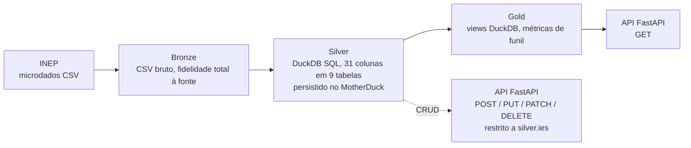

# Censo da Educação Superior (INEP)

Pipeline de dados sobre o Censo da Educação Superior do INEP, com arquitetura em camadas (bronze/silver/gold) em DuckDB e API de leitura + CRUD em FastAPI.

## Sumário

- [Contexto do projeto e dataset](#contexto-do-projeto-e-dataset)
- [Stack tecnológica](#stack-tecnológica)
- [Arquitetura](#arquitetura)
- [Status atual](#status-atual)
- [Modelo de dados](#modelo-de-dados)
- [Estrutura de pastas](#estrutura-de-pastas)
- [Como rodar](#como-rodar)
- [Autor / contato](#autor--contato)

## Contexto do projeto e dataset

Projeto desenvolvido como desafio de engenharia de dados, com o objetivo de praticar fora da stack já dominada. Na dúvida de escopo, vale o critério do próprio desafio: entregar resultado da forma mais simples e econômica possível.

Requisitos definidos para o desafio:

- Fonte de dados real, fora do Kaggle, sem organização prévia e a mais crua possível.
- CRUD completo exposto via API (não só leitura).
- Arquitetura em camadas (bronze/silver/gold).
- Todo tratamento de dados em SQL, não em pandas.
- Banco em DuckDB (decisão explícita, sem SQLAlchemy/Postgres).
- Deploy da API na nuvem, em tier gratuito (Render ou similar).

A fonte é o [Censo da Educação Superior](https://www.gov.br/inep/pt-br/acesso-a-informacao/dados-abertos/microdados/censo-da-educacao-superior), do portal de dados abertos do INEP. São microdados públicos, distribuídos como CSV (`;` como delimitador, encoding Latin-1) dentro de um zip por ano de referência.

O projeto usa somente o último censo, de 2024.

Dois arquivos de microdados são usados, unidos por `CO_IES`:

- `MICRODADOS_ED_SUP_IES_2024.CSV`: cadastro de instituições de ensino superior (84 colunas).
- `MICRODADOS_CADASTRO_CURSOS_2024.CSV`: cadastro de cursos (226 colunas).

## Stack tecnológica

| Camada                   | Ferramenta                                                                             |
| ------------------------ | -------------------------------------------------------------------------------------- |
| Linguagem                | Python 3.12+                                                                           |
| Ingestão/tratamento      | Python + DuckDB (`read_csv()`)                                                         |
| HTTP                     | `requests` + `requests-cache` (cache SQLite local)                                     |
| TLS                      | `truststore` (adapter customizado, ver [Arquitetura](#arquitetura))                    |
| Banco                    | MotherDuck (DuckDB na nuvem)                                                           |
| Configuração             | `python-dotenv`                                                                        |
| API                      | FastAPI (planejado)                                                                    |
| Deploy                   | Render (free tier), planejado                                                         |
| Gerenciamento de pacotes | `pip` + `requirements.txt` atualmente; migração para `uv` + `pyproject.toml` planejada |

## Arquitetura



### Bronze (implementada)

Em [`pipe/bronze.py`](pipe/bronze.py), a função `create_bronze()`:

1. Verifica idempotência: se os dois CSVs (IES e cursos) já existem em `data/bronze/`, não faz nada.
2. Baixa o zip completo do Censo 2024 direto do domínio `download.inep.gov.br`, usando uma sessão HTTP com cache permanente (`requests_cache`, backend SQLite em `data/cache/`), para não baixar o zip (que é grande) mais de uma vez durante o desenvolvimento.
3. Usa um adapter TLS customizado (`INEPTLSAdapter`) na sessão, porque o handshake padrão contra o servidor do INEP falha (ver detalhe abaixo).
4. Extrai em memória os dois CSVs de interesse e os grava sem nenhuma alteração, com todas as colunas da fonte. O corte de colunas fica para a camada silver.

O adaptador TLS customizado ([`pipe/utils/tls_adapter.py`](pipe/utils/tls_adapter.py)) existe porque o servidor de download do INEP derruba a conexão quando o cliente tenta negociar TLS 1.3, então o adapter trava a versão máxima em TLS 1.2. O certificado `rnp_icpedu_gr46_ov_tls_ca_2025.pem` resolve um problema separado, específico de redes acadêmicas que fazem inspeção TLS (o tráfego passa por um proxy que troca o certificado real por um assinado por uma CA da RNP). Fora desse tipo de rede ele não é necessário: o adapter carrega o arquivo, mas ele fica sem uso e não interfere na conexão.

### Silver (implementada)

Em [`pipe/silver.py`](pipe/silver.py), a função `create_silver()` lê os CSVs com `read_csv()` (todas as colunas como texto, com cast explícito na inserção), aplica a curadoria definida em [`pipe/utils/etl_utils.py`](pipe/utils/etl_utils.py) (31 das 310 colunas da fonte, ~90% de redução) e persiste um modelo normalizado de 9 tabelas no MotherDuck. O schema está em [`sql/ddl/silver.sql`](sql/ddl/silver.sql).

A carga é um full refresh dentro de uma única transação: o schema `silver` (e o `gold`, que depende dele) é apagado e recriado a cada execução. Por isso, **rodar o pipeline de novo descarta as edições feitas via CRUD**.

Regras aplicadas:

- Os nomes de IES ficam em title case, com conectivos (`de`, `da`, `do`, `das`, `dos`, `e`, `em`) em minúsculas, porque a fonte mistura nomes em caixa alta e caixa mista e o formato precisa ser adequado para servir via API. Siglas dentro do nome também são convertidas (`SENAI` → `Senai`). Esse efeito é aceito, já que preservá-las exigiria mapear todas elas.
- As siglas de IES ficam em caixa alta.
- Os códigos de rede, modalidade e nível viram booleanos (`e_publica`, `e_presencial`, `e_graduacao`).
- A fonte não informa o grau acadêmico de cursos de Área Básica de Ingresso (área CINE `00`) nem de cursos sequenciais, então a silver criou as categorias 5 e 6.
- No arquivo do INEP, cursos EAD ocupam várias linhas (uma de cabeçalho com as vagas e uma por polo com as matrículas). A silver mantém uma linha por `curso_id`, somando as métricas.

Decisões de schema que afetam o CRUD:

- `organizacao_academica_id` e `categoria_administrativa_id` são validados por `CHECK`, sem FK. O DuckDB transforma o `UPDATE` de uma coluna indexada em `DELETE` + `INSERT`, e como `silver.cursos` referencia `silver.ies`, uma FK nessas colunas bloquearia a edição delas.
- `e_publica` precisa ser coerente com a categoria (categorias 1, 2, 3 e 7 são públicas). Mudar a categoria para outra rede exige alterar os dois campos juntos.
- A FK `cursos.ies_id → ies` foi mantida: uma IES com cursos não pode ser apagada.

O CRUD exposto pela API é restrito à tabela `silver.ies`, e dentro dela só aos campos `nome`, `sigla`, `e_publica`, `organizacao_academica_id` e `categoria_administrativa_id`, os únicos campos com semântica de edição cadastral. O restante (geografia, `ies_id` como PK, métricas de docentes) é somente-leitura. `silver.cursos` é majoritariamente agregação estatística (matrículas, ingressantes, concluintes) e fica inteiramente somente-leitura, porque editar esses números não teria semântica de negócio válida.

### Gold (planejada)

Views DuckDB sobre as tabelas silver, também no MotherDuck, consumidas pelas rotas de leitura (GET) da API. `silver.cursos` tem o funil de conversão natural para qualquer view analítica sobre cursos: `qtd_vagas → qtd_inscritos → qtd_ingressantes → qtd_matriculas → qtd_concluintes`.

### API (planejada)

FastAPI, deploy no Render (free tier). Leituras (`GET`) servidas pela camada gold; CRUD (`POST`/`PUT`/`PATCH`/`DELETE`) escreve em `silver.ies`, com rotas parametrizadas (evitando duplicar handler por entidade) e validação de que o campo alvo está na lista de campos editáveis acima.

## Status atual

- [X] Camada bronze (download + fidelidade total à fonte em CSV)
- [X] Camada silver (SQL de curadoria, persistência no MotherDuck)
- [ ] Camada gold (views analíticas)
- [ ] API FastAPI (leitura via gold + CRUD paramétrico em `silver.ies`)
- [ ] Deploy no Render

## Modelo de dados

Modelo normalizado da camada silver, com o Censo 2024 (2.561 IES e 46.150 cursos). Regras de negócio estão em [Silver (implementada)](#silver-implementada).

### `silver.ies`

| Coluna                        | Tipo            | Descrição                                                            | Camada de origem |
| ----------------------------- | --------------- | -------------------------------------------------------------------- | ---------------- |
| `ies_id`                      | INTEGER, PK    | Código da IES (`CO_IES`)                                             | Silver           |
| `nome`                        | VARCHAR(200)    | Nome da IES (`NO_IES`) *(editável via CRUD)*                         | Silver           |
| `sigla`                       | VARCHAR(20)     | Sigla da IES (`SG_IES`), pode ser nula *(editável via CRUD)*         | Silver           |
| `e_publica`                   | BOOLEAN         | Rede pública? (`TP_REDE`) *(editável via CRUD)*                      | Silver           |
| `organizacao_academica_id`    | SMALLINT        | Organização acadêmica (`TP_ORGANIZACAO_ACADEMICA`) *(editável via CRUD)* | Silver           |
| `categoria_administrativa_id` | SMALLINT        | Categoria administrativa (`TP_CATEGORIA_ADMINISTRATIVA`) *(editável via CRUD)* | Silver           |
| `municipio_id`                | INTEGER, FK    | Município da sede (`CO_MUNICIPIO_IES`)                               | Silver           |
| `qtd_docentes_total`          | INTEGER         | Docentes em exercício e afastados (`QT_DOC_TOTAL`)                   | Silver           |
| `qtd_docentes_em_exercicio`   | INTEGER         | Docentes em exercício (`QT_DOC_EXE`)                                 | Silver           |

### `silver.cursos` (somente leitura)

| Coluna              | Tipo         | Descrição                                                                 | Camada de origem |
| ------------------- | ------------ | ------------------------------------------------------------------------- | ---------------- |
| `curso_id`          | INTEGER, PK | Código do curso (`CO_CURSO`)                                              | Silver           |
| `nome`              | VARCHAR(200) | Nome do curso (`NO_CURSO`)                                                | Silver           |
| `ies_id`            | INTEGER, FK | IES que oferta o curso (`CO_IES`)                                         | Silver           |
| `grau_academico_id` | SMALLINT, FK | Grau acadêmico conferido (`TP_GRAU_ACADEMICO`)                           | Silver           |
| `area_geral_id`     | SMALLINT, FK | Área geral CINE (`CO_CINE_AREA_GERAL`)                                   | Silver           |
| `e_gratuito`        | BOOLEAN      | Curso é gratuito? (`IN_GRATUITO`)                                         | Silver           |
| `e_presencial`      | BOOLEAN      | Presencial (verdadeiro) ou EAD (falso) (`TP_MODALIDADE_ENSINO`)           | Silver           |
| `e_graduacao`       | BOOLEAN      | Graduação (verdadeiro) ou sequencial (falso) (`TP_NIVEL_ACADEMICO`)       | Silver           |
| `qtd_vagas`         | INTEGER      | Total de vagas oferecidas (`QT_VG_TOTAL`)                                 | Silver           |
| `qtd_inscritos`     | INTEGER      | Total de inscritos (`QT_INSCRITO_TOTAL`)                                  | Silver           |
| `qtd_ingressantes`  | INTEGER      | Ingressantes em 01/jan e 01/jul do ano de referência (`QT_ING`)           | Silver           |
| `qtd_matriculas`    | INTEGER      | Alunos com vínculo "Cursando" ou "Formado" (`QT_MAT`)                     | Silver           |
| `qtd_concluintes`   | INTEGER      | Concluintes (`QT_CONC`)                                                   | Silver           |

### Tabelas de domínio

| Tabela                            | Colunas                                                 | Conteúdo                                         | Camada de origem |
| --------------------------------- | ------------------------------------------------------- | ------------------------------------------------ | ---------------- |
| `silver.organizacoes_academicas`  | `organizacao_academica_id` (PK), `nome`                 | 5 tipos de organização acadêmica                 | Silver           |
| `silver.categorias_administrativas` | `categoria_administrativa_id` (PK), `nome`            | 9 categorias administrativas                     | Silver           |
| `silver.graus_academicos`         | `grau_academico_id` (PK), `nome`                        | 4 graus do INEP + ABI e curso sequencial         | Silver           |
| `silver.areas_gerais_cine_brasil` | `area_geral_id` (PK), `nome`                            | 11 áreas gerais CINE                             | Silver           |
| `silver.regioes`                  | `regiao_id` (PK), `nome`                                | 5 regiões                                        | Silver           |
| `silver.ufs`                      | `uf_id` (PK), `nome`, `sigla`, `regiao_id` (FK)         | 27 UFs                                           | Silver           |
| `silver.municipios`               | `municipio_id` (PK), `nome`, `e_capital`, `uf_id` (FK)  | 698 municípios com sede de IES                   | Silver           |

## Estrutura de pastas

```
higher-education-census/
├── main.py                      # ponto de entrada do pipeline
├── requirements.txt
├── .env.example                 # variáveis do MotherDuck
├── docs/                        # dicionário de dados do INEP
├── pipe/
│   ├── bronze.py                # download + extração dos CSVs brutos
│   ├── silver.py                # curadoria em SQL + carga no MotherDuck
│   ├── certs/                   # CA da RNP (versionado — certificado público), ver Arquitetura
│   └── utils/
│       ├── etl_utils.py         # mapeamento de colunas e normalização de nomes
│       └── tls_adapter.py       # adapter HTTPS custom para o servidor do INEP
├── sql/
│   └── ddl/
│       └── silver.sql           # DDL da camada silver
└── data/                        # não versionado (.gitignore)
    ├── bronze/                  # CSVs gerados pela camada bronze
    └── cache/                   # cache HTTP local (requests-cache)
```

## Como rodar

Pré-requisitos: Python 3.12+ e uma conta no MotherDuck.

```bash
pip install -r requirements.txt
cp .env.example .env   # preencher as variáveis abaixo
python main.py
```

Isso executa `create_bronze()`, que baixa os microdados (a etapa é pulada se os CSVs já existirem em `data/bronze/`), e depois `create_silver()`, que recria as tabelas no MotherDuck.

### Variáveis de ambiente

| Variável           | Descrição                                                                                     |
| ------------------ | --------------------------------------------------------------------------------------------- |
| `MOTHERDUCK_TOKEN` | Token de autenticação do MotherDuck, usado para persistir as camadas silver/gold remotamente  |
| `DATABASE_NAME`    | Nome do banco MotherDuck onde as camadas silver/gold são criadas                              |

## Autor / contato

**Hugo Santos**

- GitHub: [@HugoBSantos](https://github.com/HugoBSantos)
- LinkedIn: [hugo-brasil-dos-santos](https://linkedin.com/in/hugo-brasil-dos-santos/)
